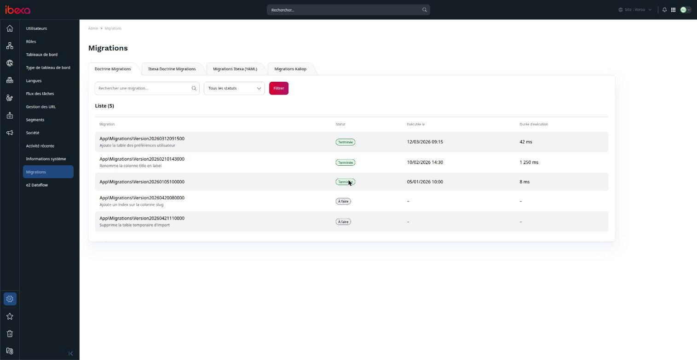
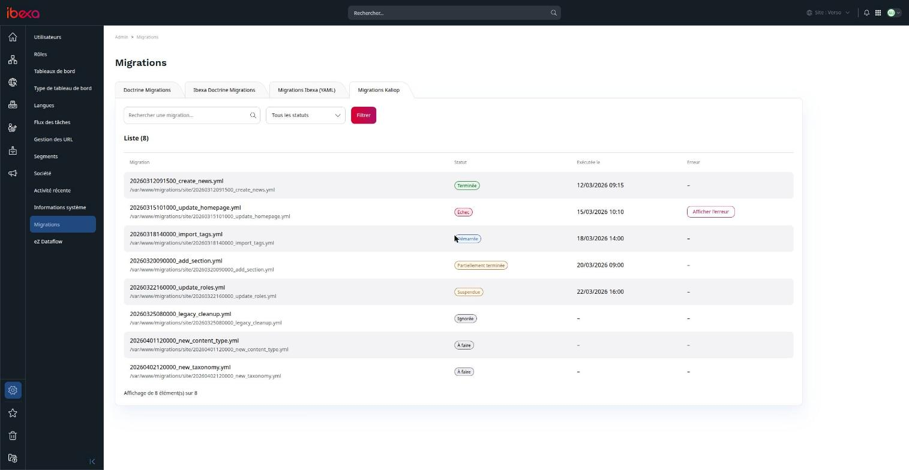

# Ibexa Migration UI Bundle

[](https://github.com/code-rhapsodie/IbexaMigrationUiBundle/actions/workflows/ci.yml)
[](https://packagist.org/packages/code-rhapsodie/ibexa-migration-ui-bundle)
[](https://packagist.org/packages/code-rhapsodie/ibexa-migration-ui-bundle)
[](LICENSE)

Admin interface for Ibexa DXP **4.6** and **5.0** that shows the content of the migration tables,
so nobody has to open a DB client to check the status of a migration.

Supported sources. Each one is detected automatically: its tab is shown only when the owning bundle is registered in the kernel and its table exists. No configuration is needed.

| Source | Table | Detected when | Shown data |
|---|---|---|---|
| Doctrine Migrations | `doctrine_migration_versions` (auto-detected from `doctrine_migrations.storage.table_storage.table_name`), without the Ibexa migrations | `DoctrineMigrationsBundle` | version (class), description, executed at, execution time |
| Ibexa Doctrine Migrations (`ibexa/doctrine-migrations`) | same table, filtered on classes tagged `ibexa.doctrine_migrations.migration` | `IbexaDoctrineMigrationsBundle` | idem + target version |
| Ibexa migrations (`ibexa/migrations`, YAML) | `ibexa_migrations` | `IbexaMigrationBundle` | name, executed at, execution time |
| Kaliop migrations (`tanoconsulting/ibexa-migration-bundle`…) | `kaliop_migrations` | `KaliopMigrationBundle` | name, path, status, executed at, error |

Details:

- **Description** (Doctrine tabs): read from the migration class `getDescription()`, shown under the name.
- **Target version** (Ibexa Doctrine tab): read from the static `getTargetVersion()` of Ibexa migrations (`IbexaMigrationInterface`).
- **Status filter**: only on the Kaliop tab, the only table that stores real statuses (to do, started, done, failed, skipped, partially done, suspended). The other tables only contain executed migrations.
- **Kaliop errors**: opened in a modal with the *Show error* button.
- **Search**: available on every tab and kept when switching tab.

The page follows Ibexa's native admin look (tabs, dropdown, table, badges, modal, pagination). The page size uses the user's *Items per page* setting (`subitems_limit`, *My account > Settings*) and dates (short format) use the user's date format and timezone settings. English and French translations are included.

## Screenshots

Doctrine Migrations tab, with executed and pending ("To do") migrations:



Kaliop tab, with every status, the file path and the error button:



Requirements: PHP 8.1+, Ibexa DXP 4.6 (Symfony 5.4, DBAL 2.13) or 5.0 (Symfony 7, DBAL 3/4).

## Installation

```bash
composer require code-rhapsodie/ibexa-migration-ui-bundle
```

```php
// config/bundles.php
CodeRhapsodie\IbexaMigrationUiBundle\CodeRhapsodieIbexaMigrationUiBundle::class => ['all' => true],
```

```yaml
# config/routes/code_rhapsodie_migration_ui.yaml
code_rhapsodie_migration_ui:
    resource: '@CodeRhapsodieIbexaMigrationUiBundle/Resources/config/routing.yaml'
```

Clear the cache, then give the policy **Migration UI / View migrations** (`migration_ui` / `view`)
to the roles that may see the page.

## Multiple databases / siteaccesses

Every tab reads the database of the repository of the current siteaccess (`ibexa.persistence.connection`):
open the page from the admin siteaccess of the repository you want to inspect.

## Access control

Two layers protect the page:

1. **Siteaccess**: the route is declared with `siteaccess_group_whitelist: '%admin_group_name%'`,
   so it is only served on siteaccesses of the admin group (any other siteaccess gets a 404).
2. **Permission**: the user needs the `migration_ui` / `view` policy. Without it the
   *Admin > Migrations* menu entry is hidden and the route returns 403.

## Pending migrations

The status filter offers **To do** to list migrations that exist but were never executed:

- **Doctrine / Ibexa Doctrine**: classes registered in the `migrations_paths` of the default
  `doctrine_migrations` configuration that have no row in the metadata table.
- **Kaliop**: migration files found on disk with no row in `kaliop_migrations`. Directories are
  read from the siteaccess-aware parameter `code_rhapsodie_migration_ui.<siteaccess|group>.kaliop_paths`
  (relative to the project directory); without it, Kaliop's default directories are scanned.

```yaml
parameters:
    code_rhapsodie_migration_ui.site_corporate_admin.kaliop_paths: ['migrations/corporate']
```

Limits: Ibexa YAML migrations (`ibexa_migrations`) have no pending list, and Doctrine migrations
passed only through `--configuration` on the command line are not known to the bundle.

## Configuration

Sources are detected automatically and the page size comes from the user's
"sub-items limit" account setting. The only optional setting is `kaliop_paths` above.

## Extending

Implement `CodeRhapsodie\IbexaMigrationUiBundle\Migration\Source\MigrationSourceInterface`
(auto-tagged) to add another source.
